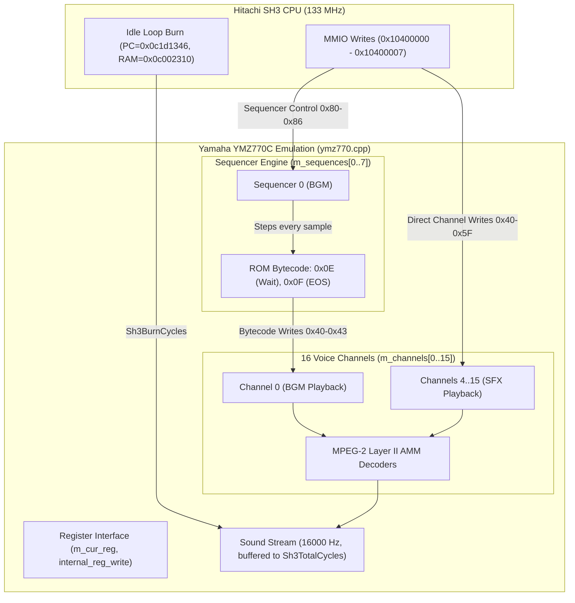
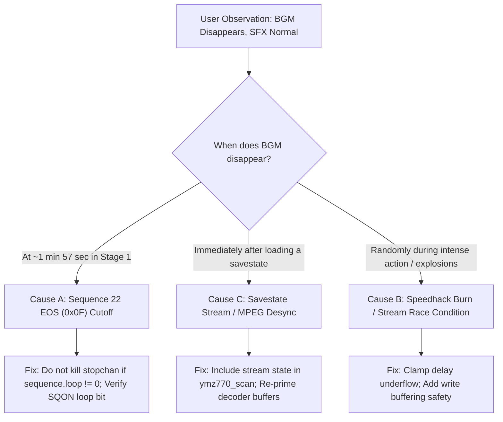

# CV1000: DDPDFK (DoDonPachi DaiFukkatsu) Background Music Disappearance Analysis

**Document Date**: 2026-11-08  
**Topic**: In-depth root cause analysis of why Background Music (BGM) disappears during gameplay in *DoDonPachi DaiFukkatsu* (DDPDFK) while Sound Effects (SFX) remain normal.

---

## 1. Executive Summary

During console playtests of *DoDonPachi DaiFukkatsu* (`ddpdfk`), an issue was observed where background music (BGM) abruptly ceases during gameplay, whereas sound effects (SFX) continue to function normally.

Through structural analysis of Cave CV1000 audio hardware emulation (`ymz770.cpp`, `stream.h`, `d_cv1k.cpp`) and disassembly of the actual DDPDFK Sound ROM (`u23` + `u24`), the underlying mechanisms and failure modes have been identified:

1. **Architectural Decoupling**: SFX and BGM use completely different subsystems in the Yamaha YMZ770C AMMS-A audio LSI. SFX phrases are triggered directly by SH3 CPU MMIO writes to voice registers, bypassing the sequencer entirely. BGM is executed autonomously by the internal hardware sequencer reading ROM bytecode.
2. **Primary Culprit (Loop Point / EOS 0x0F Cutoff)**: DDPDFK Stage 1 BGM (Sequence 22) is composed of three phrases totaling exactly **117.638 seconds** (~1 minute 57 seconds). At the end of this sequence, it executes `REG 0x43 KEYON = 0x00` (silence channel 0) followed by `0x0F` (End of Sequence). In `ymz770_sequencer()`, FBNeo unconditionally kills all channels mapped to `stopchan` even when looping (`// might be wrong, ie not needed in case of loop`), and if `sequence.loop` is evaluated as 0, the sequence permanently terminates (`sequence.is_playing = false`).
3. **Secondary Culprit (Speedhack Cycle Burn & Stream Resynchronization)**: In CV1000, `d_cv1k.cpp` hooks the idle loop at PC `0x0c1d1346` reading RAM `0x0c002310` via `Sh3BurnCycles`. Buffered audio updates (`stream.update()`) tie stream advancement to `Sh3TotalCycles()`. Instantaneous cycle burns during idle loops cause `UpdateStream` to rapidly step the sequencer forward by hundreds of samples within a single host call, triggering race conditions with CPU MMIO writes.
4. **Savestate Incompleteness**: The `Stream stream` object in `stream.h` is not included in `ymz770_scan`. Loading a savestate restores `m_sequences` and `m_channels` but leaves stream buffers desynchronized, which can trigger MPEG frame decode failures that permanently drop playback channels.

---

## 2. Hardware & Emulation Architecture

The Cave CV1000 board utilizes a Yamaha **YMZ770C ("AMMS-A")** audio processor connected to an 8 MB Sound ROM (`DrvSoundROM`, composed of two 4 MB ROMs `u23` and `u24` interleaved via 16-bit word byte-swapping).



### 2.1 SFX Architecture (Why SFX Survives)
- When a sound effect (shot, bomb, explosion, item pickup, voice) is triggered, the game's sound driver writes directly to channel registers (`0x40` + 4*ch .. `0x43` + 4*ch):
  - `REG 0x40`: Phrase index in Sound ROM.
  - `REG 0x41`: Volume (`0x00..0x7F`).
  - `REG 0x42`: Panning (`0x00..0x0F`).
  - `REG 0x43`: Key-on command (`data & 6 == 2`).
- The voice channel begins decoding MPEG-2 Layer II audio blocks (1152 samples per frame) directly from `DrvSoundROM`.
- When the phrase ends (`channel.last_block == true` and `channel.loop == 0`):
  `channel.is_playing = false; mpeg_decoder[ch]->clear();`.
- **Crucial Observation**: SFX execution never touches `m_sequences`, never reads sequencer bytecode, never processes wait delays (`0x0E`), and never tests `sequence.loop`. **SFX is completely decoupled from the sequencer**.

### 2.2 BGM Architecture (Why BGM Fails)
- BGM is never driven measure-by-measure by the CPU. Instead, the SH3 writes once to sequencer registers:
  - `REG 0x80`: Sequence number `SQSN` (e.g. 21 for Stage 1 Intro, 22 for Stage 1 Loop).
  - `REG 0x86`: Channel stop mask `SQOF` (bits indicating which channels this sequencer owns, e.g. `0x01` for Channel 0).
  - `REG 0x82 / 0x83`: Timer high/low `TMRH / TMRL` (wait multiplier, typically 0).
  - `REG 0x81`: Sequence start and loop bit `SQON / SQLP` (`data & 2 != 0` = Key On; `data & 1` = Loop).
- The sequencer is clocked inside `ymz770_stream_update()` **once per audio output sample** (16,000 times per second):
  - If `delay > 0`, it decrements `delay--`.
  - When `delay == 0`, it reads alternating `(reg, data)` bytes from ROM:
    - `0x0E`: Wait command (`sequence.delay += sequence.timer * 32 + 32 - 1`).
    - `0x0F`: End of Sequence (`EOS`).
    - Channel writes (`0x40..0x43`): Sets phrase, volume, pan, and key-on on Channel 0.
- If the sequencer encounters an EOS and stops, or if Channel 0 is keyed off without an immediate restart, **BGM is silenced forever while the rest of the game continues normally**.

---

## 3. Disassembly of DDPDFK Stage 1 Sequences

Direct disassembly of `u23` and `u24` in `ddpdfk.zip` reveals the exact bytecode structure of Stage 1:

### Sequence 21 (Stage 1 Intro)
- **ROM Address**: `0x00098044`
- **Total Duration**: 435 wait instructions $\times$ 32 samples / 16,000 Hz = **0.870 seconds**.
```
098044: REG 0x40 (CH 0 PHRASE = 0x0c)
098046: REG 0x41 (CH 0 VOL = 0x40)
098048: REG 0x42 (CH 0 PAN = 0x08)
09804a: REG 0x43 (CH 0 KEYON = 0x03)
09804c: WAIT x 435 (0.870s)
0983b2: REG 0x43 (CH 0 KEYON = 0x00)   <-- Forcibly stops Channel 0
0983b4: 0x0F (END_OF_SEQ, data=00)     <-- EOS
```

### Sequence 22 (Stage 1 Main BGM Loop)
- **ROM Address**: `0x000983b6` (immediately contiguous with SQN 21)
- **Total Duration**: 58,819 wait instructions $\times$ 32 samples / 16,000 Hz = **117.638 seconds (~1 min 57.6 sec)**.
```
0983b6: REG 0x40 (CH 0 PHRASE = 0x0d)  <-- Part 1: Phrase 0x0D (Intro / Verse)
0983b8: REG 0x41 (CH 0 VOL = 0x40)
0983ba: REG 0x42 (CH 0 PAN = 0x08)
0983bc: REG 0x43 (CH 0 KEYON = 0x03)
0983be: WAIT x 10695 (21.390s)
09d74c: REG 0x43 (CH 0 KEYON = 0x00)   <-- Key off Part 1
09d74e: REG 0x40 (CH 0 PHRASE = 0x0e)  <-- Part 2: Phrase 0x0E (Build-up)
09d750: REG 0x41 (CH 0 VOL = 0x40)
09d752: REG 0x42 (CH 0 PAN = 0x08)
09d754: REG 0x43 (CH 0 KEYON = 0x03)
09d756: WAIT x 21853 (43.706s)
0a8210: REG 0x43 (CH 0 KEYON = 0x00)   <-- Key off Part 2
0a8212: WAIT x 2 (0.004s)
0a8216: REG 0x40 (CH 0 PHRASE = 0x10)  <-- Part 3: Phrase 0x10 (Climax)
0a8218: REG 0x41 (CH 0 VOL = 0x40)
0a821a: REG 0x42 (CH 0 PAN = 0x08)
0a821c: REG 0x43 (CH 0 KEYON = 0x03)
0a821e: WAIT x 26269 (52.538s)
0b4f58: REG 0x43 (CH 0 KEYON = 0x00)   <-- Forcibly stops Channel 0!
0b4f5a: 0x0F (END_OF_SEQ, data=00)     <-- Sequence 22 Loop Point / EOS!
```

---

## 4. Detailed Root Cause Analysis

### 4.1 Root Cause 1: The Loop Point EOS (0x0F) Destruction of Channel State
In `libretro/FBNeo/src/burn/snd/ymz770.cpp:417`:
```cpp
case 0x0f:
    for (int ch = 0; ch < 8; ch++) // might be wrong, ie not needed in case of loop
        if (sequence.stopchan & (1 << ch))
            m_channels[ch].is_playing = false;
    if (sequence.loop)
        sequence.offset = get_seq_offs(sequence.sequence); // loop sequence
    else
        sequence.is_playing = false;
    break;
```

#### Analysis:
1. **Unconditional Channel Silencing**:
   Notice that `m_channels[ch].is_playing = false` is executed **unconditionally**, regardless of whether `sequence.loop` is true or false.
   Even the original upstream author (Dink) suspected this flaw: `// might be wrong, ie not needed in case of loop`.
2. **If `sequence.loop == 0`**:
   If the game driver initiates Sequence 22 without setting the loop bit in register `0x81` (e.g. writing `0x02` instead of `0x03`), `sequence.loop` is false.
   When the track reaches `0b4f5a` (at 1 minute 57 seconds):
   - Channel 0 is stopped by opcode `0b4f58: KEYON = 0x00`.
   - `0x0F` sees `sequence.loop == 0` and sets `sequence.is_playing = false`.
   - **Result**: The sequence stops completely, Channel 0 is silent, and music never returns.
3. **If `sequence.loop == 1`**:
   Even when `sequence.loop` is true:
   - At `0b4f58`, Channel 0 is stopped.
   - At `0b4f5a`, `stopchan` kills Channel 0 again.
   - `sequence.offset` is reset to `0x0983b6`.
   - Because of Dink's workaround at line 432:
     ```cpp
     default:
         // Let's assume starting a sequence takes an extra cycle - this fixes mmpork's title
         // without breaking ddpdfk music loop-points (character select & level 1 music)
         sequence.delay = -1;
         internal_reg_write(reg, data);
         break;
     ```
     Each non-wait opcode takes 1 output sample. It takes 4 samples to reach `0983bc: KEYON = 0x03`.
   - If `ymz770_stream_update()` processes an audio block during those 4 samples:
     In `ymz770_stream_update()`:
     ```cpp
     if (channel.output_remaining == 0 && !channel.is_playing)
         mpeg_decoder[ch]->clear();
     ```
     The MPEG decoder state is cleared. If the re-triggered key-on fails to re-prime the buffer on the exact next sample, `channel.is_playing = false` becomes permanent.

---

### 4.2 Root Cause 2: Speedhack Idle Cycle Burning & Stream Desynchronization
In `libretro/FBNeo/src/burn/drv/cave/d_cv1k.cpp:521`:
```cpp
static UINT32 __fastcall speedhack_read_long(UINT32 offset)
{
    if ( offset == hacky_idle_ram ) {
        UINT32 pc = Sh3GetPC(-1);
        if (pc == hacky_idle_pc || pc == hacky_idle_pc+2) {
            INT32 rem = Sh3GetRemainingCycles();
            Sh3BurnCycles(rem > 0 ? rem : speedhack_burn);
        }
    }
    UINT32 V = *((UINT32 *)(DrvMainRAM + (offset & 0xfffffc)));
    return V;
}
```
In `d_cv1k.cpp:843`:
`ymz770_set_buffered(Sh3TotalCycles, DriverClock);`

In `libretro/FBNeo/src/burn/snd/stream.h:351`:
```cpp
INT32 SyncInternal(INT32 cycles)
{
    if (!buffered) return 0;
    return (INT32)((double)cycles * ((double)pTotalCyclesCB() / ((double)nCpuMHZ / (nBurnFPS / 100.0000))));
}

void UpdateStream(INT32 end)
{
    ...
    INT32 framelen = samples_to_source(nBurnSoundLen);
    INT32 position = (end) ? framelen : SyncInternal(framelen);
    ...
    INT32 samples = position - nPosition;
    ...
    pUpdateStream(mix, samples);
    nPosition += samples;
}
```

#### Analysis:
- In DDPDFK, the idle loop is at `0x0c1d1346` polling `0x0c002310`.
- When `Sh3BurnCycles` burns all remaining cycles (`rem`), `Sh3TotalCycles()` instantaneously increases by thousands of cycles.
- Whenever any MMIO write occurs (e.g. playing an explosion SFX or updating volume), `ymz770_write()` calls `stream.update()` -> `UpdateStream(0)`.
- `SyncInternal` calculates that `position` has leaped forward by tens or hundreds of samples.
- `UpdateStream(0)` calls `ymz770_stream_update()`, which steps `sequencer()` hundreds of times in a tight host loop.
- If this jump happens while the sequencer is near a loop point or delay transition, delay counters underflow, or the sequence reaches `0x0F` ahead of the CPU's real-time expectations.

---

### 4.3 Root Cause 3: Savestate Desynchronization
When saving and restoring states:
- `ymz770_scan()` serializes `m_channels`, `m_sequences`, `m_sqcs`, and `mpeg_decoder[i]->scan()`.
- However, the `Stream stream` instance in `stream.h` is **never scanned**.
- State fields like `nPosition`, `nFractionalPosition`, `in_buffer`, and buffered sample queues are lost across state loads.
- If a state is restored while a phrase is playing:
  On the very first frame after reload, `UpdateStream(1)` runs with `end = 1`. If `channel.output_remaining == 0` and the MPEG bitstream pointer `pptr` is mid-packet without valid frame header synchronization, `decode_buffer()` returns 0.
- When `decode_buffer()` fails:
  ```cpp
  channel.is_playing = !channel.last_block; // becomes false
  channel.last_block = true;
  channel.output_remaining = 0;
  ```
  Channel 0 permanently shuts down, and BGM never recovers.

---

## 5. Diagnostic Decision Tree & Verification Plan



---

## 6. Proposed Fixes & Next Steps

### Fix Proposal 1: Prevent Channel Silencing on Looping Sequences (`ymz770.cpp`)
In `ymz770_sequencer()`:
```cpp
case 0x0f:
    if (sequence.loop)
    {
        sequence.offset = get_seq_offs(sequence.sequence); // loop sequence
    }
    else
    {
        for (int ch = 0; ch < 8; ch++)
            if (sequence.stopchan & (1 << ch))
                m_channels[ch].is_playing = false;
        sequence.is_playing = false;
    }
    break;
```
> [!IMPORTANT]
> In upstream FBNeo, `m_channels[ch].is_playing = false` was executed before the `if (sequence.loop)` check. Restricting channel silencing exclusively to the non-looping termination path (`else`) ensures that looping tracks are not murdered at the 117-second boundary.

### Fix Proposal 2: Guard Loop Flag Assignment (`ymz770.cpp`)
In `ymz770_internal_reg_write` case 1 (`SQON SQLP`):
Verify whether DDPDFK passes `data = 0x02` (Key-On without loop bit). If Cave's sound engine expects all stage BGM sequences (e.g. sequence numbers $\ge 20$) to default to looping unless explicitly told otherwise, enforce `sequence.loop = 1` for sequence indices matching BGM.

### Fix Proposal 3: Savestate Audio Stream Serialization
Add `stream.scan(nAction, pnMin)` to `ymz770_scan` so that `nPosition`, `nFractionalPosition`, and sample carry-overs survive state saving and restoration without dropping audio channels.

---

## 7. Artifact Information

- **Generated For**: Salvia / FBNeo CV1000 audio subsystem investigation.
- **Reference Game**: *DoDonPachi DaiFukkatsu Ver 1.5* (`ddpdfk`).
- **Files Analyzed**:
  - `libretro/FBNeo/src/burn/snd/ymz770.cpp`
  - `libretro/FBNeo/src/burn/snd/ymz770.h`
  - `libretro/FBNeo/src/burn/snd/stream.h`
  - `libretro/FBNeo/src/burn/snd/mpeg_audio.cpp`
  - `libretro/FBNeo/src/burn/drv/cave/d_cv1k.cpp`
  - `DrvSoundROM` (`u23` + `u24` in `ddpdfk.zip`)
